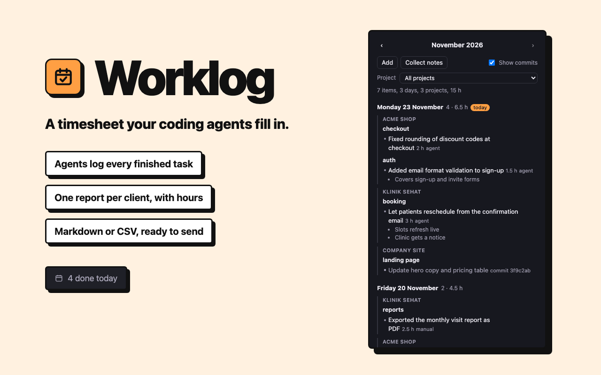

# Worklog: Timesheets for Orca

A timesheet your agents fill in. Every finished task becomes a line in your work log, sorted by day, project and area, ready to send as a monthly report.



## How it works

- **Agents log their own work.** When an agent finishes a task, it writes a short note to `.worklog/<slug>.md` in its workspace: one past-tense sentence of what was done, an `area:` line (checkout, auth, landing page…) and up to three details. Notes are written in the language you choose.
- **Git never sees the notes.** `.worklog/` is added to each local repository's `.git/info/exclude`, which applies only on your computer and is never committed.
- **Orca keeps them.** Every 15 seconds new notes move into the plugin's private store, so they survive when a worktree is deleted.
- **Your commits fill the gaps.** Your own commits (matched by `git config user.email`) are added too, with the area guessed from the folders they touched. A commit is left out wherever the same day and project already has a written note, so reports are not cluttered with commit messages. Turn commits off in settings.
- **Add or fix anything by hand.** Click an entry to change its text, area, project, date, hours or details.
- **Projects are remembered per repository.** When a workspace is not linked to an Orca project, pick a project for one of its entries once: its other entries without a project, and every later note or commit from that repository, get the same project.

The status bar shows how many things you logged today; click it for the list.

## Monthly report

Pick a month, group by project or by date, add your name (hours, when filled in, are totalled per day or project and for the month), then copy the report or download it as Markdown, or as CSV for Excel or Google Sheets.

Working for several clients? Choose one project in the **Project** filter at the top: the list and the report then hold only that project's work. Its name goes into the title and the file name (`worklog-2026-11-shop.md`), and the panel warns about entries that have no project yet, since those are left out.

## Backup

The log lives only in Orca on this computer. Under **Back up your data** in the panel, download a backup (one JSON file) now and then, and restore it after moving to another computer or reinstalling. Restoring only adds what is missing: entries already present, including the same commit logged on both computers, are skipped, and nothing is overwritten or deleted.

## Set up your agents

Open **Set up your agents** in the panel, copy the instructions and paste them once into your agent's global instructions, for example `~/.claude/CLAUDE.md` (Claude Code), `~/.codex/AGENTS.md` (Codex) or `~/.gemini/GEMINI.md` (Gemini CLI).

## Limits

Only workspaces on this computer are read. Hours are entered by hand; they are not measured or guessed from agent sessions. Requires Orca 1.4.259 or later.

## Development

```sh
orca plugin validate .
orca plugin dev load .
orca plugin dev request . worklog.month '{"month":"2026-11"}'
orca plugin logs local.worklog
node --test test/*.test.mjs
```

## License

MIT
